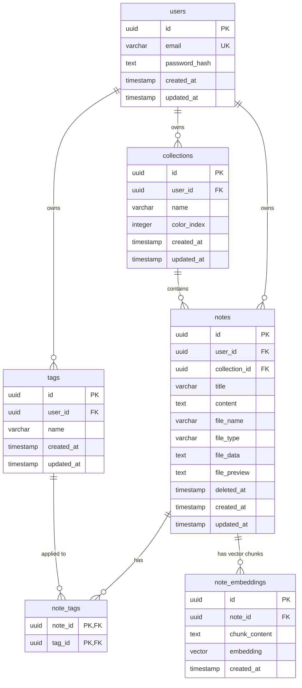

# Entity Relationship Diagram (ERD) — NoteMind

This document details the entity relationships in the NoteMind PostgreSQL database schema.

---

## Entity Descriptions & Constraints

1. **`users`**: Represents application users with unique emails and hashed credentials.
2. **`collections`**: Folders owned by users to categorize notes. `color_index` is unique per user and remains attached to the collection so its color is stable across the app.
3. **`notes`**: Core document entity. Soft linked to collections (`ON DELETE SET NULL`) and owned by users (`ON DELETE CASCADE`). `deleted_at` marks notes in Trash; restoring clears it, while permanent deletion removes the note and its dependent records.
4. **`tags`**: Unique tag names per user (`@@unique([userId, name])`).
5. **`note_tags`**: Junction table maintaining many-to-many relationship between Notes and Tags.
6. **`note_embeddings`**: Vector embedding table storing 768-dimensional vectors with `pgvector` for similarity queries.
